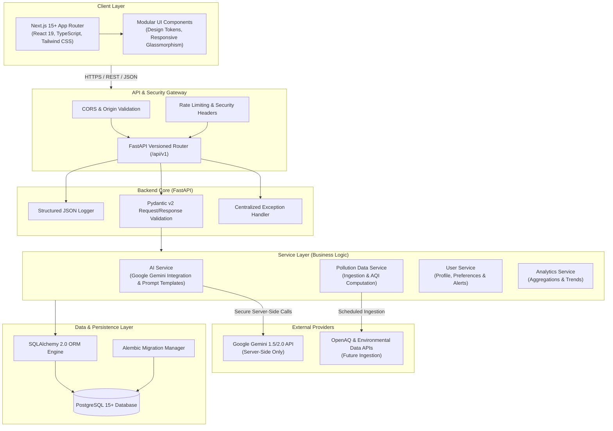

# AIRWISE AI — System Architecture Specification

## 1. System Overview

AIRWISE AI is an enterprise-grade GenAI-powered pollution intelligence and assistance platform. The platform is architected to provide real-time air quality indexing, hyper-local pollution intelligence, predictive environmental analytics, and contextual AI-driven health and action recommendations.



---

## 2. Layer-by-Layer Architectural Breakdown

### 2.1 Presentation Layer (Frontend)
- **Framework**: Next.js (App Router), React, TypeScript.
- **Styling**: Tailwind CSS with custom design tokens, midnight dark theme (`#070B12`, `#0B111E`), electric blue (`#0066FF`, `#38BDF8`) and cyan (`#00F2FE`) accents.
- **UI Paradigm**: Minimalist, content-first, high information density with zero decorative hero artwork or 3D bloat.
- **Security Boundary**: Zero sensitive credentials (no `GEMINI_API_KEY`, no database URLs) are packaged into the frontend bundle. All external data access proxies through the FastAPI backend.

### 2.2 API & Ingress Layer (FastAPI Backend)
- **Framework**: FastAPI (Python 3.11+ / 3.14 compatible) with ASGI server (Uvicorn).
- **Versioning**: Strict `/api/v1` namespace for all domain endpoints (`/api/v1/health`, `/api/v1/ai`, `/api/v1/pollution`, `/api/v1/analytics`, `/api/v1/users`).
- **Middleware**:
  - CORS with explicit origin whitelisting (`FRONTEND_URL`).
  - Request ID injection for end-to-end tracing.
  - Global exception interception returning normalized RFC-7807 compliant error schemas.

### 2.3 Layered Application Architecture (Module 03)

The backend follows a strict 5-layer separation of concerns:

```
HTTP Client / Next.js Frontend
        ↓
1. API Router Layer (app/api/v1/endpoints/)
   - Versioned endpoint handlers (/locations, /pollution, /conversations, /messages, /feedback)
   - Dependency injection (get_db session)
   - RFC-compliant response wrapping (SuccessResponse[T] / ErrorResponse)
        ↓
2. Validation Layer (app/schemas/)
   - Pydantic v2 schemas with ConfigDict(from_attributes=True)
   - Strict field validators (coordinates, AQI 0-500, ratings 1-5, particulate ranges)
        ↓
3. Service Layer (app/services/)
   - Domain business logic, deduplication, orchestration, analytical aggregations
        ↓
4. Repository Layer (app/repositories/)
   - Data access abstraction, SQL queries, filtering, sorting, pagination
        ↓
5. Data & Persistence Layer (app/models/ + SQLAlchemy 2.0 + PostgreSQL)
   - 6 relational entities: User, Location, PollutionObservation, Conversation, Message, Feedback
   - Declarative Base with TimeStampedModel mixins
   - Connection pooling (QueuePool, pool_pre_ping=True, pool_recycle=1800)
   - Alembic versioned migrations with reversible up/down paths
   - Zero-crash local SQLite fallback engine when PostgreSQL 5432 is unavailable
```

### 2.4 Service Catalog (app/services/)
- **AI Service (`app.services.ai`)**:
  - Provider abstraction interface (`BaseAIProvider`) enabling zero-downtime model upgrades.
  - Concrete `GeminiService` using Google GenAI SDK.
  - Modular prompt template management with strict environmental safety and scientific grounding rules.
- **Pollution Service (`app.services.pollution_service`)**:
  - Ingestion validation, multi-pollutant metrics persistence, and summary aggregations (avg/min/max AQI, PM2.5, PM10).
- **Location Service (`app.services.location_service`)**:
  - Spatial coordinates validation, station deduplication by name/city/country, and CRUD operations.
- **Conversation Service (`app.services.conversation_service`)**:
  - Dialogue session management, lifecycle control, and optional user scoping.
- **Message Service (`app.services.message_service`)**:
  - Chronological message persistence, role validation (`user`, `assistant`, `system`), and dialogue retrieval.
- **Feedback Service (`app.services.feedback_service`)**:
  - Quality ratings (1–5) and user sentiment persistence.
- **Analytics Service (`app.services.analytics_service`)**:
  - Computes moving averages, historical trends, and exposure hazard indices.

### 2.5 Data Persistence Layer
- **Database Engine**: PostgreSQL with connection pooling via SQLAlchemy 2.0.
- **Session Management**: Scoped generator dependency (`get_db`) ensuring deterministic connection release.
- **Schema Evolution**: Alembic migration tracking versioned DDL changes with rollback capabilities (`001_initial_schema.py`).

---

## 3. Security Architecture & Threat Model

### 3.1 Authentication & Credential Security (Module 04)
1. **Password Hashing with Argon2id**:
   - Implemented via `argon2-cffi` with standard OWASP-recommended parameters (`time_cost=2`, `memory_cost=65536`, `parallelism=1`).
   - Resistant to GPU/ASIC cracking and side-channel timing attacks.
   - Enforced complexity policy: minimum 12 characters, uppercase, lowercase, numbers, symbols, and a blacklist of common weak passwords.
2. **Dual-Token JWT & Refresh Token Rotation**:
   - Short-lived Access Tokens (15 minutes) signed with HMAC-SHA256 containing minimal payload (`sub`, `role`, `type: access`, `iat`, `exp`).
   - Long-lived cryptographically secure random Refresh Tokens (7 days) stored hashed (SHA-256) in the database (`refresh_tokens` table).
   - Atomic single-use rotation: each refresh call revokes the existing refresh token and generates a new pair.
   - Reuse attack detection: if a revoked refresh token is presented, all refresh tokens belonging to that user are immediately revoked, invalidating all active sessions.
3. **Session Cookie Isolation & CSRF Protection**:
   - Tokens can be delivered via `Set-Cookie` headers with `HttpOnly`, `SameSite=Lax`, and `Secure` (in production) flags.
   - HttpOnly cookies prevent script-level XSS exfiltration of session credentials.
4. **Role-Based Access Control (RBAC)**:
   - User roles: `USER` and `ADMIN`.
   - FastAPI dependency injectors `require_authenticated_user` and `require_admin` guard protected operations.
   - User profile update guards strictly prevent self-elevation of roles or modification of account verification status.
5. **Secret Isolation**:
   - `SECRET_KEY`, `GEMINI_API_KEY`, database connection strings, and cryptographic salts exist strictly in server-side environment variables loaded via Pydantic `BaseSettings`.
   - Frontend accesses backend endpoints only via relative or configured base URLs (`NEXT_PUBLIC_API_URL`).
6. **CORS Enforcement**:
   - Backend restricts origin headers to authorized frontend hosts.
7. **Graceful Degradation**:
   - If PostgreSQL or Gemini services are temporarily unreachable, the health check and service endpoints degrade gracefully with structured error codes rather than unhandled 500 crashes.

---

## 4. Scalability & Extensibility Roadmap

- **Stateless Backend**: The FastAPI backend is entirely stateless, allowing horizontal pod autoscaling behind an ingress controller or cloud load balancer.
- **Microservice Readiness**: While structured as a clean modular monolith in Module 01, each service (`ai`, `pollution`, `user`, `analytics`) maintains clean domain boundaries with independent schemas and repositories, enabling seamless migration into dedicated microservices should scale require it.
