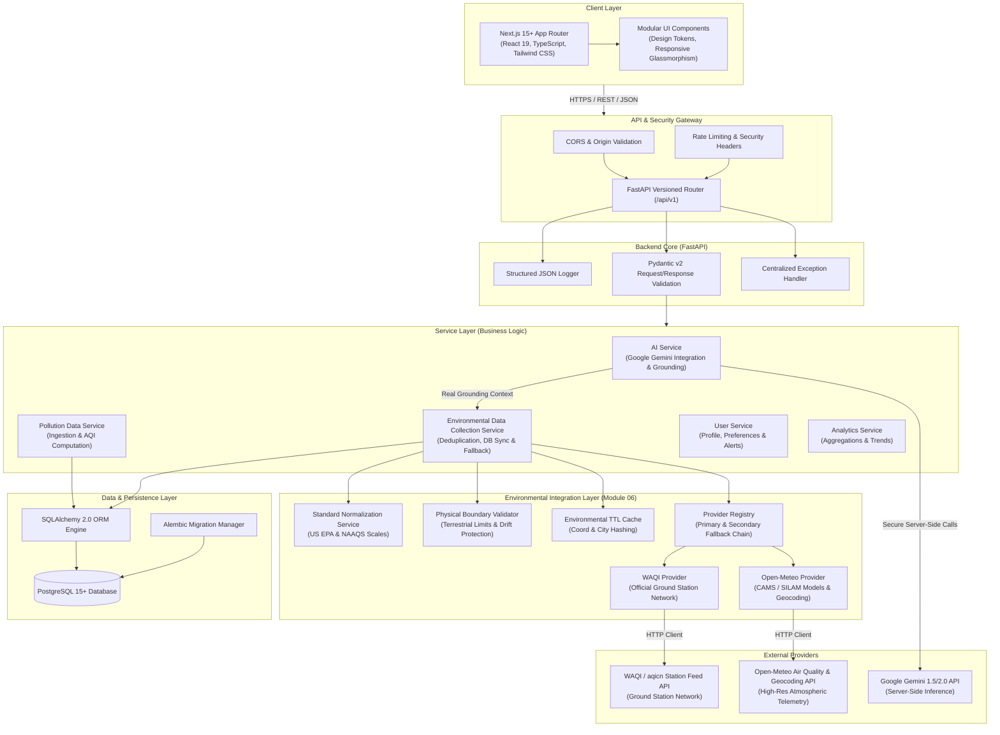

# AIRWISE AI — System Architecture Specification

## 1. System Overview

AIRWISE AI is an enterprise-grade GenAI-powered pollution intelligence and assistance platform. The platform is architected to provide real-time air quality indexing, hyper-local pollution intelligence, predictive environmental analytics, and contextual AI-driven health and action recommendations.



---

## 2. Layer-by-Layer Architectural Breakdown

### 2.1 Presentation Layer (Frontend)
- **Framework**: Next.js (App Router), React, TypeScript.
- **Styling**: Tailwind CSS with custom design tokens, midnight dark theme (`#070B12`, `#0B111E`), electric blue (`#0066FF`, `#38BDF8`) and cyan (`#00F2FE`) accents.
- **UI Paradigm**: Minimalist, content-first, high information density with zero decorative hero artwork or 3D bloat.
- **Security Boundary**: Zero sensitive credentials (no `GEMINI_API_KEY`, no database URLs) are packaged into the frontend bundle. All external data access proxies through the FastAPI backend.

### 2.2 API & Ingress Layer (FastAPI Backend)
- **Framework**: FastAPI (Python 3.11+ / 3.14 compatible) with ASGI server (Uvicorn).
- **Versioning**: Strict `/api/v1` namespace for all domain endpoints (`/api/v1/health`, `/api/v1/ai`, `/api/v1/pollution`, `/api/v1/analytics`, `/api/v1/users`).
- **Middleware**:
  - CORS with explicit origin whitelisting (`FRONTEND_URL`).
  - Request ID injection for end-to-end tracing.
  - Global exception interception returning normalized RFC-7807 compliant error schemas.

### 2.3 Layered Application Architecture (Module 03)

The backend follows a strict 5-layer separation of concerns:

```
HTTP Client / Next.js Frontend
        ↓
1. API Router Layer (app/api/v1/endpoints/)
   - Versioned endpoint handlers (/locations, /pollution, /conversations, /messages, /feedback)
   - Dependency injection (get_db session)
   - RFC-compliant response wrapping (SuccessResponse[T] / ErrorResponse)
        ↓
2. Validation Layer (app/schemas/)
   - Pydantic v2 schemas with ConfigDict(from_attributes=True)
   - Strict field validators (coordinates, AQI 0-500, ratings 1-5, particulate ranges)
        ↓
3. Service Layer (app/services/)
   - Domain business logic, deduplication, orchestration, analytical aggregations
        ↓
4. Repository Layer (app/repositories/)
   - Data access abstraction, SQL queries, filtering, sorting, pagination
        ↓
5. Data & Persistence Layer (app/models/ + SQLAlchemy 2.0 + PostgreSQL)
   - 6 relational entities: User, Location, PollutionObservation, Conversation, Message, Feedback
   - Declarative Base with TimeStampedModel mixins
   - Connection pooling (QueuePool, pool_pre_ping=True, pool_recycle=1800)
   - Alembic versioned migrations with reversible up/down paths
   - Zero-crash local SQLite fallback engine when PostgreSQL 5432 is unavailable
```

### 2.4 Service Catalog (app/services/)
- **AI Service (`app.services.ai`)**:
  - Provider abstraction interface (`BaseAIProvider`) enabling zero-downtime model upgrades.
  - Concrete `GeminiService` using Google GenAI SDK.
  - Modular prompt template management with strict environmental safety and scientific grounding rules.
- **Pollution Service (`app.services.pollution_service`)**:
  - Ingestion validation, multi-pollutant metrics persistence, and summary aggregations (avg/min/max AQI, PM2.5, PM10).
- **Location Service (`app.services.location_service`)**:
  - Spatial coordinates validation, station deduplication by name/city/country, and CRUD operations.
- **Conversation Service (`app.services.conversation_service`)**:
  - Dialogue session management, lifecycle control, and optional user scoping.
- **Message Service (`app.services.message_service`)**:
  - Chronological message persistence, role validation (`user`, `assistant`, `system`), and dialogue retrieval.
- **Feedback Service (`app.services.feedback_service`)**:
  - Quality ratings (1–5) and user sentiment persistence.
- **Analytics Service (`app.services.analytics_service`)**:
  - Computes moving averages, historical trends, and exposure hazard indices.

### 2.5 Data Persistence Layer
- **Database Engine**: PostgreSQL with connection pooling via SQLAlchemy 2.0.
- **Session Management**: Scoped generator dependency (`get_db`) ensuring deterministic connection release.
- **Schema Evolution**: Alembic migration tracking versioned DDL changes with rollback capabilities (`001_initial_schema.py`).

---

## 3. Security Architecture & Threat Model

### 3.1 Authentication & Credential Security (Module 04)
1. **Password Hashing with Argon2id**:
   - Implemented via `argon2-cffi` with standard OWASP-recommended parameters (`time_cost=2`, `memory_cost=65536`, `parallelism=1`).
   - Resistant to GPU/ASIC cracking and side-channel timing attacks.
   - Enforced complexity policy: minimum 12 characters, uppercase, lowercase, numbers, symbols, and a blacklist of common weak passwords.
2. **Dual-Token JWT & Refresh Token Rotation**:
   - Short-lived Access Tokens (15 minutes) signed with HMAC-SHA256 containing minimal payload (`sub`, `role`, `type: access`, `iat`, `exp`).
   - Long-lived cryptographically secure random Refresh Tokens (7 days) stored hashed (SHA-256) in the database (`refresh_tokens` table).
   - Atomic single-use rotation: each refresh call revokes the existing refresh token and generates a new pair.
   - Reuse attack detection: if a revoked refresh token is presented, all refresh tokens belonging to that user are immediately revoked, invalidating all active sessions.
3. **Session Cookie Isolation & CSRF Protection**:
   - Tokens can be delivered via `Set-Cookie` headers with `HttpOnly`, `SameSite=Lax`, and `Secure` (in production) flags.
   - HttpOnly cookies prevent script-level XSS exfiltration of session credentials.
4. **Role-Based Access Control (RBAC)**:
   - User roles: `USER` and `ADMIN`.
   - FastAPI dependency injectors `require_authenticated_user` and `require_admin` guard protected operations.
   - User profile update guards strictly prevent self-elevation of roles or modification of account verification status.
5. **Secret Isolation**:
   - `SECRET_KEY`, `GEMINI_API_KEY`, database connection strings, and cryptographic salts exist strictly in server-side environment variables loaded via Pydantic `BaseSettings`.
   - Frontend accesses backend endpoints only via relative or configured base URLs (`NEXT_PUBLIC_API_URL`).
6. **CORS Enforcement**:
   - Backend restricts origin headers to authorized frontend hosts.
7. **Graceful Degradation**:
   - If PostgreSQL or Gemini services are temporarily unreachable, the health check and service endpoints degrade gracefully with structured error codes rather than unhandled 500 crashes.

### 3.2 AI Assistant Security & Guardrails (Module 05)
1. **Prompt Injection & Untrusted Data Defense**:
   - User inputs and retrieved sensor observations are treated as untrusted strings and encapsulated in structured envelopes.
   - The central system prompt strictly instructs the LLM to refuse persona overrides, ignore instructions attempting to access credentials, and maintain its dedicated role.
2. **Medical & Health Boundaries**:
   - The system prompt forbids clinical diagnoses and prescription recommendations, mandating qualified clinical consultation advice.
3. **Telemetry Attribution & Anti-Hallucination**:
   - Real-time measurements must only be cited when explicitly provided in the observation context, accompanied by data source and timestamp.
   - Absence of local readings triggers transparent fallback disclaimers.
4. **Rate Limiting & Abuse Prevention**:
   - `UsageService` enforces per-user daily sliding-window caps (`AI_MAX_DAILY_REQUESTS=50`).
   - Input strings are validated against `AI_MAX_INPUT_LENGTH=5000` to prevent buffer exhaustion and token-bloat attacks.
5. **Architectural Evaluation: Standard Response vs. Streaming**:
   - Module 05 implements standard async request/response generation. This architecture guarantees atomic transaction boundaries: user inquiries and assistant responses are committed to PostgreSQL together with accurate usage metrics only upon successful generation. This completely eliminates partial failure inconsistencies, corrupted history chains, and connection drop state anomalies inherent in early-stage SSE implementations.

### 3.3 Environmental Analytics, Geospatial & Data Export Security (Module 07)
1. **Scientific Scale Compatibility & Cross-Location Integrity**:
   - Comparing air quality metrics computed under different national regulatory standards (e.g., US EPA AQI vs. Indian NAAQS AQI) is scientifically invalid due to differing breakpoint concentrations and sub-index formulas.
   - `ComparisonService` inspects scale metadata across compared locations, flagging incompatibilities in the response payload and omitting deceptive direct arithmetic difference calculations when scales diverge.
2. **Anti-CSV Injection (Formula Sanitization)**:
   - Exported tabular environmental data is sanitized against Dynamic Data Exchange (DDE) and formula injection exploits in desktop spreadsheet applications (Microsoft Excel, LibreOffice Calc, Google Sheets).
   - Any text or numerical field starting with dangerous control characters (`=`, `+`, `-`, `@`, `\t`, `\r`) is prefixed with a single apostrophe (`'`) prior to streaming.
3. **Non-Null Descriptive Statistical Rigor**:
   - Statistical operations (mean, median, standard deviation, percentage trajectory) are executed solely on non-null recorded sensor observations.
   - Zero-values are preserved as genuine physical readings, whereas missing records are excluded rather than coerced to zero to avoid distorting epidemiological metrics.
4. **Geospatial Privacy & Spatial Integrity**:
   - The geospatial mapping subsystem strictly presents actual known monitoring station coordinates.
   - Interpolated or simulated pollution heatmaps are explicitly avoided to prevent presenting speculative spatial distributions as measured facts.

### 3.4 Personalization, Smart Alert Evaluation & Multi-Channel Notification Architecture (Module 08)
1. **User Personalization & Localization**:
   - Preferences are modeled under `UserPreference` linked to the central user account with 1-to-1 semantics.
   - Supports user-configurable temperature units (`C`, `F`), AQI scales (`US_EPA`, `IN_NAAQS`, `EU_CAQI`), IANA timezones, and quiet-hours delivery windows (`quiet_hours_enabled`, `quiet_hours_start`, `quiet_hours_end`).
   - Environmental vulnerability and interests are stored as structured JSON arrays enabling tailored recommendation prompts.
2. **Multi-Location Management & Strict Tenancy Isolation**:
   - `SavedLocation` enables users to bookmark monitoring stations or cities with custom labels ("Home", "Office") and a single primary location designation.
   - Cross-user access is prevented at the database query level: all mutations verify `user_id == current_user.id`, returning 404 for unauthorized access attempts.
3. **Smart Alert Evaluation Engine**:
   - `AlertService` inspects real physical observations against user-defined rules with configurable metric, comparison operator (`>`, `>=`, `<`, `<=`), and threshold values.
   - **Scale Incompatibility Safety**: If an alert rule targets a specific AQI scale (e.g., `US_EPA`), incoming observations from differing scales (e.g., `IN_NAAQS`) are omitted from evaluation to prevent false alarms caused by differing breakpoint curves.
   - **Cooldown Throttling**: Each rule enforces a configurable cooldown window (`cooldown_minutes`, default 60m). Subsequent breaching observations within the cooldown window are suppressed to eliminate alert fatigue.
   - **Demo & Missing Data Filtering**: Unverified demo observations and missing metric records are strictly rejected from triggering notifications.
4. **Multi-Channel Notification Dispatcher**:
   - `NotificationDispatcher` orchestrates delivery across enabled channels:
     - `in_app`: Persisted to PostgreSQL `notifications` table with read/unread tracking and severity grading.
     - `email`: Background email dispatch abstraction with console delivery logging in development and SMTP readiness.
     - `web_push`: W3C Web Push specification compliance with VAPID subscription schemas and push payload distribution.
   - During active quiet hours, non-critical notifications are suppressed or deferred while emergency alerts bypass quiet hours.
5. **Personalized Recommendation Engine & Caching**:
   - `RecommendationService` generates tailored actionable lifestyle, ventilation, and commuting guidance.
   - Fuses current localized multi-pollutant telemetry and meteorological context with user vulnerability interests.
   - Powered by Google Gemini API with strict JSON schema outputs and a deterministic clinical fallback engine adhering to WHO Air Quality Guidelines when AI is in standby.
   - Employs `RecommendationCache` with configurable TTL (`RECOMMENDATION_CACHE_TTL_SECONDS=3600`) to minimize redundant LLM token expenditures.

### 3.5 Admin Dashboard, Data Review Governance & Audit Architecture (Module 09)
1. **Administrative Authentication & Authorization (RBAC)**:
   - Access to administrative functionality is guarded on both frontend and backend.
   - The backend enforces `get_current_admin_user`, verifying valid dual-token JWT signatures and `role == "ADMIN"`. Non-admin requests immediately return `403 Forbidden`.
   - The frontend uses `AdminLayout` route guards, redirecting unauthenticated users to `/login?redirect=/admin` and non-admin users to `/dashboard`.
2. **Critical Administrative Safety Invariants**:
   - **Self-Deactivation Guard**: Administrators are strictly prevented from deactivating their own active accounts, preventing accidental administrative lockouts.
   - **Last-Admin Safeguard**: The system verifies the active administrator count before executing status or role mutations. Actions that would deactive or demote the sole active administrator in the database return `400 Bad Request`.
3. **Environmental Telemetry Quality Review & Immutability**:
   - Observations can be flagged or reviewed by administrators (`APPROVED`, `REJECTED`, `FLAGGED`).
   - Every review creates an audit record in `environmental_reviews` capturing the reviewer ID, previous status, new status, and review justification notes.
   - **Strict Physical Measurement Immutability**: Original sensor measurements (AQI, PM2.5, PM10, gaseous concentrations, weather variables) are strictly immutable and cannot be overwritten by administrative reviews.
4. **Persistent, Redacted Audit Logging**:
   - All administrative mutations are recorded in the `audit_logs` table via `AuditService`.
   - Captures administrator ID, email, action type, target model, target ID, client IP address, and user agent.
   - Sensitive credentials (passwords, tokens, API keys) are automatically sanitized to `"[REDACTED]"` prior to storage.
5. **Infrastructure Observability & External Provider Diagnostics**:
   - Live health checks inspect database latency and table row counts across all platform entities.
   - Provider health monitors continuously report latency and operational status for Open-Meteo and WAQI.
   - AI token expenditure and daily query ceilings are monitored to prevent budget exhaustion.

### 3.6 Production Hardening, Observability & Containerization Architecture (Module 10)
1. **Multi-Layer Security Headers**:
   - Both the FastAPI backend (`SecurityHeadersMiddleware`) and Next.js frontend (`next.config.ts`) inject standardized HTTP security headers: `X-Content-Type-Options: nosniff`, `X-Frame-Options: DENY`, `X-XSS-Protection`, `Referrer-Policy: strict-origin-when-cross-origin`, `Permissions-Policy`, and `Strict-Transport-Security` (HSTS).
2. **Denial-of-Service & Payload Sizing Protection**:
   - `RequestSizeLimiterMiddleware` enforces a strict 10MB payload size limit, terminating oversized requests with HTTP 413 prior to memory allocation.
   - `SimpleRateLimiterMiddleware` enforces in-memory sliding-window throttling on authentication routes (`/auth/login`, `/auth/register`, `/auth/forgot-password`) to mitigate brute-force credential stuffing.
3. **End-to-End Request Tracing & Latency Observability**:
   - `RequestTracingMiddleware` assigns or propagates `X-Request-ID` across every HTTP request, calculates wall-clock execution duration in milliseconds, sets `X-Process-Time`, and outputs structured correlation logs.
4. **Containerization & Principle of Least Privilege**:
   - Multi-stage Docker builds isolate compilation tools (gcc, build-essential, npm) from production runtime images.
   - Backend runs under unprivileged `appuser` (UID 1001), and frontend runs under unprivileged `nextjs` (UID 1001).
5. **Orchestrator Probes**:
   - `GET /api/v1/health/live`: Fast process liveness check for container restart decisions.
   - `GET /api/v1/health/ready`: Database dependency readiness check for ingress traffic routing.

---

## 4. Scalability & Extensibility Roadmap

- **Stateless Backend**: The FastAPI backend is entirely stateless, allowing horizontal pod autoscaling behind an ingress controller or cloud load balancer.
- **Microservice Readiness**: While structured as a clean modular monolith in Module 01, each service (`ai`, `pollution`, `user`, `analytics`) maintains clean domain boundaries with independent schemas and repositories, enabling seamless migration into dedicated microservices should scale require it.
