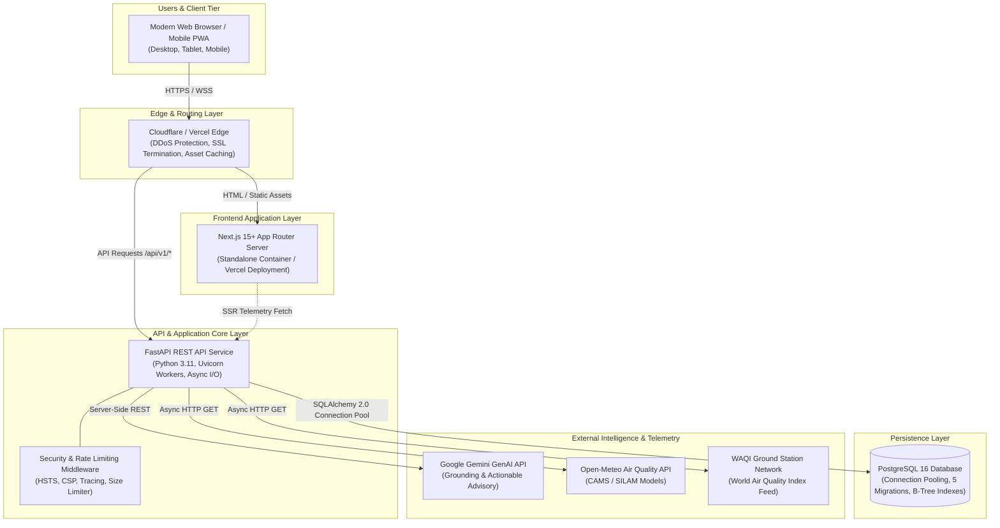

# AIRWISE AI — Deployment Architecture

**Document:** `docs/deployment-architecture.md`  
**Date:** November 21, 2026  
**Status:** Evaluated & Documented  

---

## 1. Architecture Overview

AIRWISE AI is architected as a modern decoupled web platform consisting of a Next.js App Router frontend, a high-concurrency FastAPI REST backend, a persistent PostgreSQL relational store, Google Gemini server-side AI integration, and external environmental data provider feeds.

---

## 2. Platform Comparison & Evaluation

| Criteria | Option A: Vercel + Cloud Run + Neon | Option B: Unified Docker (Render / DigitalOcean) | Option C: Full Self-Hosted (AWS EC2 / Hetzner) |
|---|---|---|---|
| **Cost** | Free/Low tier eligible (~$0–$15/mo) | Predictable flat rate (~$14–$25/mo) | Fixed infrastructure (~$10–$20/mo) |
| **Operational Overhead** | Minimal (Serverless & Managed) | Very Low (Git-push container deployment) | High (OS updates, firewall maintenance) |
| **Scaling Characteristics** | Auto-scales from 0 to peak | Vertical & manual horizontal scaling | Manual scaling behind load balancer |
| **Database Management** | Fully managed with automated backups | Managed DB add-on | Manual PostgreSQL administration |
| **Fit for AIRWISE AI** | **Recommended Tier 1** | **Recommended Tier 2** | Not recommended for current phase |

### Selection Rationale: Option A / Option B
- **Frontend**: Deploying the Next.js frontend on Vercel provides out-of-the-box global edge CDN, image optimization, instant preview branches, and zero cold starts.
- **Backend**: Containerizing the FastAPI backend with our multi-stage `Dockerfile` and deploying to Google Cloud Run or Render provides seamless environment variable management, automatic HTTPS, connection pool scaling, and zero idle costs when scaled to zero.
- **Database**: Managed PostgreSQL (Supabase, Neon, or Cloud SQL) provides automated daily snapshots, point-in-time recovery (PITR), and SSL connections.
