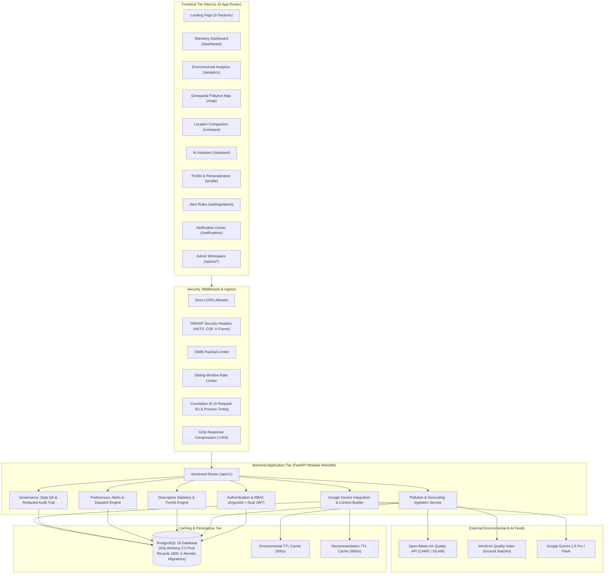

# AIRWISE AI — Final Application Architecture Specification

**Document:** `docs/final-application-architecture.md`  
**Date:** November 21, 2026  
**Status:** Unified Production Architecture  

---

## 1. System Topology & Tiering

AIRWISE AI is designed as a modular monolith with decoupled client and server tiers:

---

## 2. Core Architectural Guarantees & Invariants

1. **Measurement Immutability**: Administrative quality reviews can change verification status (`verified`, `flagged`, `rejected`), but original physical sensor measurements (AQI, PM2.5, PM10, gases, weather) are immutable.
2. **Administrative Lockout Protection**: Self-deactivation and demotion of the last active administrator in the database are strictly rejected.
3. **Scale Incompatibility Safety**: Cross-location comparisons explicitly flag when differing national AQI scales are compared, preventing deceptive direct differences.
4. **Formula Injection Sanitization**: Tabular CSV exports escape dangerous control characters with apostrophes.
5. **Zero Credential Exposure**: Client browser bundles contain no API keys; audit logs redact passwords and secrets to `"[REDACTED]"`.
