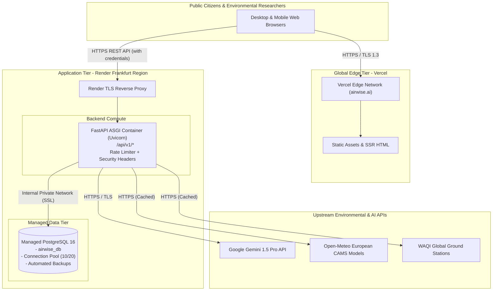

# AIRWISE AI — Final Deployment Architecture Blueprint

This document details the selected cloud architecture, service hosting breakdown, communication protocols, network boundaries, and cost analysis for AIRWISE AI.

---

## 1. Hosting Provider Comparison & Architecture Selection

| Component | Option A (Selected) | Option B (Alternative) | Selection Rationale |
| :--- | :--- | :--- | :--- |
| **Frontend** | **Vercel** (Next.js Global Edge Network) | Render Web Service / AWS Amplify | Native Next.js 15 App Router optimization, edge caching, zero cold starts, automated SSL, global CDN distribution. |
| **Backend API** | **Render Web Service** (Docker Runtime) | Google Cloud Run / AWS ECS | Continuous container deployments from GitHub, built-in TLS, simple environment variables, zero-ops background workers, zero cold starts on paid tier. |
| **Database** | **Render Managed PostgreSQL** (or Supabase/Neon) | AWS RDS / Google Cloud SQL | Low-latency private network communication with Render backend, automated daily backups, SSL enforcement, zero egress fees within the same region. |

---

## 2. High-Level Architecture Diagram

---

## 3. Communication & Security Flow

1. **Client to Frontend**:
   - End users access `https://airwise.ai` over HTTPS.
   - Vercel serves static HTML/JS/CSS assets from edge caches nearest to the user.
2. **Client to Backend API**:
   - The Next.js frontend calls the backend REST API via `https://api.airwise.ai` (or Render assigned URL `https://airwise-backend.onrender.com`).
   - Every request passes through `SecurityHeadersMiddleware`, `SimpleRateLimiterMiddleware`, and `RequestSizeLimiterMiddleware`.
   - Dual authentication: Bearer tokens are sent in the `Authorization` header for API routes; HttpOnly `Secure` cookies are sent for `/api/v1/auth/refresh`.
3. **Backend to Database**:
   - Backend connects to managed PostgreSQL over private internal cloud networking with SSL mode enabled.
   - Connection pool is configured with `pool_size=10`, `max_overflow=20`, and `pool_recycle=1800` (30 minutes).
4. **Backend to External Services**:
   - **Google Gemini**: Secure API key transmitted via server-side HTTPS headers; deterministic fallback if unavailable.
   - **Open-Meteo & WAQI**: Ingested on demand or via background tasks with 15-minute and 30-minute in-memory caching to minimize external API consumption.

---

## 4. Estimated Recurring Infrastructure Costs

| Service Tier | Provider | Specification | Estimated Monthly Cost |
| :--- | :--- | :--- | :--- |
| **Frontend** | Vercel | Hobby Tier (Free) / Pro ($20/user/mo) | **$0.00** (Free tier covers 100GB bandwidth) |
| **Backend API** | Render | Starter Web Service (0.5 CPU, 512MB RAM) | **$7.00 / month** |
| **Database** | Render | Starter PostgreSQL (1GB RAM, 10GB SSD) | **$7.00 / month** |
| **External APIs** | Google AI Studio | Free Tier (15 RPM) / Pay-as-you-go | **$0.00** (Within free tier limits) |
| **Environmental** | Open-Meteo & WAQI | Open-Access / Free Tier | **$0.00** |
| **Total Estimated Cost** | — | High-reliability baseline | **$14.00 / month** |

> [!NOTE]
> Free-tier evaluation option: Render offers a 90-day free PostgreSQL instance and a free Web Service (with sleep-on-idle). For 24/7 uptime without cold starts, the Starter tier ($14/month total) is recommended.
