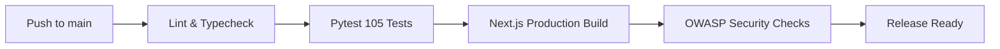

# AIRWISE AI — Production Release & CI/CD Process

This document details the release engineering workflow, deployment triggers, automated checks, and zero-downtime rolling update process.

---

## 1. Automated CI Pipeline Overview (`.github/workflows/ci.yml`)

Every pull request and merge into `main` triggers automated validation:

1. **Lint & Typecheck**:
   - Python flake8/ruff formatting check.
   - Next.js TypeScript strict check (`tsc --noEmit`).
2. **Automated Test Suite**:
   - Runs `pytest tests -v` (105 tests including unit, integration, and E2E journeys).
3. **Next.js Production Compilation**:
   - Executes `npm run build` to verify that all 32 static and dynamic routes compile.
4. **Security Audit**:
   - `pip-audit` / `npm audit` scanning for known vulnerabilities.

---

## 2. Release Deployment Execution

Once CI checks succeed:
1. **Database Migration First**:
   - Run `alembic upgrade head` before updating application code.
   - All migrations are forward-compatible, allowing existing running pods to continue querying the database while new tables or columns are added.
2. **Backend Rolling Deployment**:
   - Render or Cloud Run pulls the new Docker image and starts a new container instance.
   - The orchestrator probes `GET /api/v1/health/live`.
   - Once healthy, traffic is routed to the new container and the old container is gracefully shut down.
3. **Frontend Edge Deployment**:
   - Vercel automatically deploys the compiled output to global edge points of presence.
   - Atomic deployments ensure users never experience broken or partially updated JavaScript chunks.
